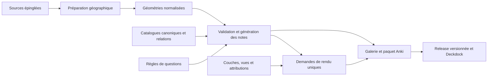

# Revue d’architecture — 21 octobre 2026

Périmètre : dépôt complet au commit `7353175`, puis examen de la compatibilité
Deckdock. Cette revue porte sur la logique, la maintenabilité et le coût d’ajout
de contenu. Les constats ci-dessous sont distincts des extensions géographiques,
que l’auteur a demandé de mettre de côté.

## État et conclusion

1 014 notes, neuf sous-decks, 50 tests réussis. Paquet construit et contrôlé :
326 PNG embarqués, empreintes correctes, toutes les références de médias résolues.
Les 889 identifiants du commit précédent sont présents dans le nouveau projet.

Le socle est exploitable et plusieurs décisions doivent être conservées : données
locales, géométries séparées des questions, règles communes au lieu de notes écrites
une à une, identifiants indépendants du texte, scènes partagées SVG/PNG et médias
adressés par contenu. Ces choix permettent déjà de faire évoluer un grand nombre
de notes avec peu de règles.

En revanche, l’ajout rapide de thèmes a créé des doubles sources de vérité et des
branches métier dans les composants communs. Il faut consolider ces frontières
avant de reprendre les extensions. Il n’est pas nécessaire de réécrire le projet,
d’ajouter une base de données ou de construire un système de plugins.

Priorités : **catalogues canoniques, préparation non destructive, propagation correcte
des règles, puis configuration explicite du rendu et de l’export**.

## Constats prioritaires

### R1 — P1 : un objet peut avoir plusieurs noms et faits concurrents

Références : [préparation hydrographique](../../scripts/prepare_hydrography.py#L42),
[génération des relations](../../src/french_geography/generate.py#L157),
[catalogue des destinations](../../catalog/river-destinations.yml),
[catalogue des relations](../../catalog/river-relations.yml).

Le Rhône est nommé dans `rivers.yml` et dans `river-destinations.yml`. Les noms,
explications et références des affluents existent dans `hydrography-extension.yml`,
`rivers.yml` et `river-relations.yml`. Les villes portuaires recopient aussi les noms
de `cities.yml` dans `port-coasts.yml`. Ces copies sont validées individuellement,
sans garantir qu’elles décrivent toujours le même objet.

**Reproduction réalisée sur une copie temporaire :** renommer le Rhône dans
`catalog/rivers.yml` produit « Le Rhône modifié » sur sa carte, alors que la relation
Isère → Rhône répond encore « Rhône ». Le chargement réussit.

**Correction recommandée :** conserver une fiche canonique par objet. Les relations
référencent ses identifiants ; leurs éventuels faits et références propres sont portés
par la relation. Les règles sélectionnent les objets et résolvent leurs noms dans le
même registre en mémoire. Garder des catalogues thématiques, pas un immense fichier
universel. Les fichiers dérivés doivent être clairement marqués et vérifiés si on
choisit de les conserver.

**Critère d’acceptation :** une modification du nom canonique se répercute sur toutes
les questions/réponses concernées, sans autre édition ni changement d’identité.

### R2 — P1 : les préparateurs peuvent écraser l’éditorial et certifier une revue

Références : [sommets](../../scripts/prepare_peaks.py#L14),
[écriture de leur catalogue](../../scripts/prepare_peaks.py#L73),
[lacs et explications](../../scripts/prepare_water_places.py#L59),
[état de revue hydrographique](../../scripts/prepare_hydrography.py#L55).

Les scripts contiennent noms français, explications, cadrages et références, puis
réécrivent les catalogues. Une correction éditoriale du YAML peut disparaître à la
préparation suivante. L’ajout d’un sommet ou d’un lac demande encore de modifier le
script Python. Plus problématique, `prepare_hydrography.py` affecte systématiquement
`verified` et la date `2026-10-20`, même après changement du texte ou des références.
Une exécution technique n’est pas une revue factuelle.

**Correction recommandée :** séparer les sélections techniques (codes amont et
transformations), les données normalisées et les fiches éditoriales maintenues.
Les préparateurs produisent des géométries et des attributs sourcés, sans réécrire
les textes validés. L’état de revue doit porter sur une empreinte du texte et des
références : une modification remet la fiche à relire, sans la certifier automatiquement.

**Critère d’acceptation :** rejouer une préparation conserve une correction éditoriale ;
modifier un fait ne peut pas conserver silencieusement une ancienne validation.

### R3 — P1 : la règle d’identification ignore sa couche lors de la création de note

Références : [règle acceptée](../../src/french_geography/schema.py#L87),
[construction de Card](../../src/french_geography/generate.py#L60),
[valeurs par défaut](../../src/french_geography/schema.py#L18).

Le générateur lit les géométries de `rule.layer`, mais ne transmet pas cette couche à
`Card`. La note reçoit donc la valeur par défaut `rivers`. Le thème reste également
`Fleuves`. La série actuelle fonctionne parce qu’elle emploie justement cette couche.

**Reproduction réalisée :** une règle d’identification configurée sur une couche
`streams` génère une note dont `layer == 'rivers'`. Une nouvelle famille peut donc
sembler valide tout en affichant le mauvais contexte ou en échouant au rendu.

**Correction recommandée :** propager explicitement les propriétés de la règle et
clarifier si cette règle est générique ou exclusivement hydrographique. Ajouter un
cas de non-régression avec un nom de couche différent. Préserver les IDs existants.

## Frontières à clarifier

### R4 — P2 : les nouveaux thèmes nécessitent encore des modifications transversales

Références : [relations optionnelles](../../src/french_geography/schema.py#L139),
[enum des relations](../../src/french_geography/schema.py#L180),
[texte Insee dans le générateur](../../src/french_geography/generate.py#L178),
[crédits](../../src/french_geography/build.py#L24),
[decks](../../src/french_geography/build.py#L196),
[rendu selon le nom de couche](../../src/french_geography/cartography/__init__.py#L106).

`PlaceEntry` accumule les champs facultatifs `capital`, `department`, `massif`,
`downstream`, `ocean`, `coast`. Ajouter un type de relation oblige à toucher le schéma
et le générateur. Ajouter un thème demande un deck en Python, souvent des crédits
et parfois des branches dans le rendu. Le générateur décide aussi qu’une relation
administrative vient d’Insee 2025. Les sources peuvent évoluer sans que ce texte et
les crédits codés en dur suivent.

**Reproduction réalisée :** remplacer le thème de la règle des parcs par
« Nouveau thème » passe `load()`, puis l’export échoue avec `KeyError('Nouveau thème')`.

**Cible simple :** un registre de decks avec IDs stables ; des métadonnées de couches
qui déclarent style, contexte et attribution ; des relations dont les gabarits et
références sont déclarés. Des modèles thématiques peuvent rester distincts : DRY ne
signifie pas imposer tous les champs possibles à tous les objets.

Le cas francilien doit être une déclaration de contexte (« frontières départementales
dans cette vue »), utilisée aussi pour les dépendances du cache, plutôt qu’une
condition métier recopiée entre rendu et export.

### R5 — P2 : la préparation est une suite de scripts dont l’ordre reste implicite

Références : [socle initial](../../scripts/prepare_geography.py#L19),
[réécriture des sorties](../../scripts/prepare_geography.py#L54),
[fond mondial](../../scripts/prepare_world_context.py#L29),
[écriture des entrées composites](../../scripts/prepare_water_places.py#L25).

`prepare_geography.py` et les scripts d’extension écrivent les mêmes fichiers.
Relancer seulement le premier peut rétablir 18 cours d’eau et un fond limité à
l’Europe. Les catalogues, géométries et registres sont écrits successivement, ce qui
peut laisser un état partiel en cas d’erreur. Les scripts reconstruisent les mêmes
opérations de lecture/écriture, réparation, empreinte et mise à jour de registre.
Certains libellés de version sont fixes sans vérifier que l’entrée correspond au
millésime attendu.

**Correction recommandée :** petites fonctions communes de préparation, étapes
avec entrées/sorties explicites et une commande qui expose leur ordre. Calculer puis
valider toutes les sorties avant remplacement. Vérifier les empreintes amont attendues.
Les données préparées restent disponibles pour les builds ordinaires hors ligne.
Un orchestrateur court suffit ; aucun framework ETL n’est requis à ce stade.

### R6 — P2 : le cache fonctionne, mais fait trop de travail par note

Références : [clé et contrôles](../../src/french_geography/build.py#L80),
[police SVG](../../src/french_geography/cartography/__init__.py#L151),
[police PNG](../../src/french_geography/cartography/__init__.py#L186).

La clé inclut toutes les vues : ajouter une vue sans rapport invalide les autres
rendus. La même dépendance contextuelle est décrite séparément dans le cache et
le renderer. Chaque recto/verso re-vérifie les fichiers déjà vérifiés et recopie les
mêmes médias dans la galerie. Le SVG embarque une police entière alors que les
images ne contiennent plus de texte ; le PNG charge aussi cette police.

**Mesures locales, pas un benchmark universel :** pour 1 014 cartes et 326 médias
PNG distincts, un passage en cache chaud a effectué 2 684 lectures de médias,
soit 1 069,8 Mio, en 0,79 s sur ce poste. Les 326 SVG actifs occupent 208,8 Mio,
contre 42,7 Mio de PNG. Le cache historique contient davantage de fichiers ; ces
tailles ne sont pas celles du paquet compressé.

**Correction recommandée :** construire d’abord les demandes de rendu uniques,
vérifier/copier chaque média une fois par exécution, inclure seulement la vue et son
encart dans les dépendances, supprimer le chemin texte/police devenu inutile. Les
images doivent continuer à être nommées par empreinte. Différer parallélisation et
index spatial tant qu’une mesure ne justifie pas leur complexité.

### R7 — P2 : renforcer les contrats et les tests des ajouts

Références : [registre de sources](../../src/french_geography/project.py#L26),
[validation finale](../../src/french_geography/project.py#L88),
[fixture de paquet](../../tests/test_project.py#L25).

Le registre de sources est un dictionnaire peu typé. La détection des doublons
s’appuie sur `layers`, qui n’enregistre pas les références non géographiques : deux
sources `kind: reference` portant le même ID sont acceptées. Ce cas a été reproduit.
Le thème, la cohérence cible/couche et les dépendances contextuelles ne sont pas
tous vérifiés avant export. Les scénarios d’import et les préparateurs ne sont pas
couverts de bout en bout par la CI actuelle.

Les tests existants ont une vraie valeur ; toutefois le test appelé
`test_offline_package_contains_all_notes_and_media` utilise les seules identifications
hydrographiques. Un autre couvre un échantillon de départements. Cela ne constitue
pas une couverture automatique de tous les thèmes d’export.

**Correction recommandée :** schéma de source avec registre d’IDs indépendant,
validation des thèmes/couches/relations avant rendu, un export multithème minimal
hors ligne et tests ciblés de régénération. Ajouter aux tests les cas R1/R2/R3 au
moment de leur correction, sans remplir la suite de tests qui recopient chaque YAML.

### R8 — P2 : rendre visibles les changements d’inventaire et d’identité

Références : [exclusion des réponses contenues dans les questions](../../src/french_geography/generate.py#L165),
[GUID et export](../../src/french_geography/build.py#L20),
[conventions actuelles](../ANKI_IDS.md).

Les identités sont correctement fondées sur des clés stables. Mais l’inventaire dépend
de conditions éditoriales : modifier un nom ou une qualification peut faire apparaître
ou disparaître une relation. Une exclusion par sous-chaîne ne prouve pas toujours
qu’une question divulgue sa réponse. Les mises à jour de paquet ne retirent pas les
anciennes notes de la collection ; cela exige une politique explicite.

**Correction recommandée :** inventaire des notes et résumé des ajouts/retraits par
build/release, motifs d’exclusion explicites, tests de conservation d’IDs et de mise
à jour. Tout changement d’algorithme doit maintenir les IDs déjà diffusés ; ne pas
renommer `villes-chefs-lieux` juste pour harmoniser son nom technique.

## Ce qui doit rester simple

- Conserver Python, YAML et GeoJSON ; aucun serveur ni base de données nécessaire.
- Garder la séparation rendu/export et la génération en mémoire.
- Mutualiser les invariants techniques, pas les détails métier qui diffèrent réellement.
- Déplacer la variabilité fréquente dans les données, sans fabriquer un langage de règles.
- Conserver un lecteur de catalogues canonique et quelques fonctions de préparation.
- Prioriser la sécurité des modifications éditoriales avant les optimisations de vitesse.

## Ordre de consolidation proposé

1. **Correctifs de logique :** propagation de couche (R3), validation des thèmes et
   doublons de sources (partie de R7). Petits changements avec tests de régression.
2. **Source de vérité :** catalogues canoniques, relations par IDs, revue liée au
   contenu et préparateurs non destructifs (R1/R2). C’est le gain DRY principal.
3. **Ajout de thème :** registre de decks/couches/attributions et gabarits de relation
   (R4). Faire passer les séries existantes par ces mêmes contrats.
4. **Préparation reproductible :** étapes explicites, sorties validées, fonctions
   partagées, test d’une régénération complète (R5).
5. **Cache et maintenance :** demandes uniques, suppression des polices inutiles,
   inventaire des notes et couverture multithème (R6/R7/R8).

À chaque étape : mêmes IDs, mêmes réponses sauf correction volontaire documentée,
aucune perte d’historique à l’import, build hors ligne et crédits exacts. La revue
ne constitue pas une réécriture automatique du moteur : les refactorings restent
à réaliser après accord sur leur ordre.

## Compatibilité Deckdock et limites de validation

Le contrôle complémentaire est détaillé dans [DECKDOCK.md](../DECKDOCK.md).
Il utilise le code réel de Deckdock, pas une réimplémentation de ses règles.
Les 67 tests de son checkout `34c797fa8f6546ece8aa0a7e31f90f745ef7a38e` passent.

Un test isolé avec le backend Anki 26.9.3 a importé les 1 014 notes, puis modifié
une question dans un second paquet et réimporté. Le nombre de notes et cartes reste
1 014, l’identité de la note est conservée, ainsi qu’un enregistrement de révision
synthétique et les valeurs de planification de test. Aucune collection utilisateur
n’a été ouverte. Ce test n’est pas une validation des dialogues de l’add-on ni du mobile.

Les contrôles GitHub distants et l’installation depuis une vraie release restent
à vérifier après publication. Le dépôt a été configuré et `main` poussé à la demande
de l’auteur pendant cette revue. La publication d’une release n’a pas été demandée.

## État après préparation de la distribution

Les sept tests du contrat de workflow portent le contrôle local à **57 tests réussis**.
Le script Deckdock passe contre la révision épinglée avec le paquet réel ; GitHub
est simulé dans ce test. La vérification distante confirme que le nouveau dépôt est
public. Le workflow de publication et son chemin d’artefact sont contrôlés, sans
création de tag ni de release. Les constats R1 à R8 restent des travaux de consolidation,
à l’exception des contrôles de distribution déjà ajoutés.

Une cible de séparation possible, à faire évoluer progressivement :

Ce diagramme décrit la direction recommandée, pas un refactoring déjà réalisé.
